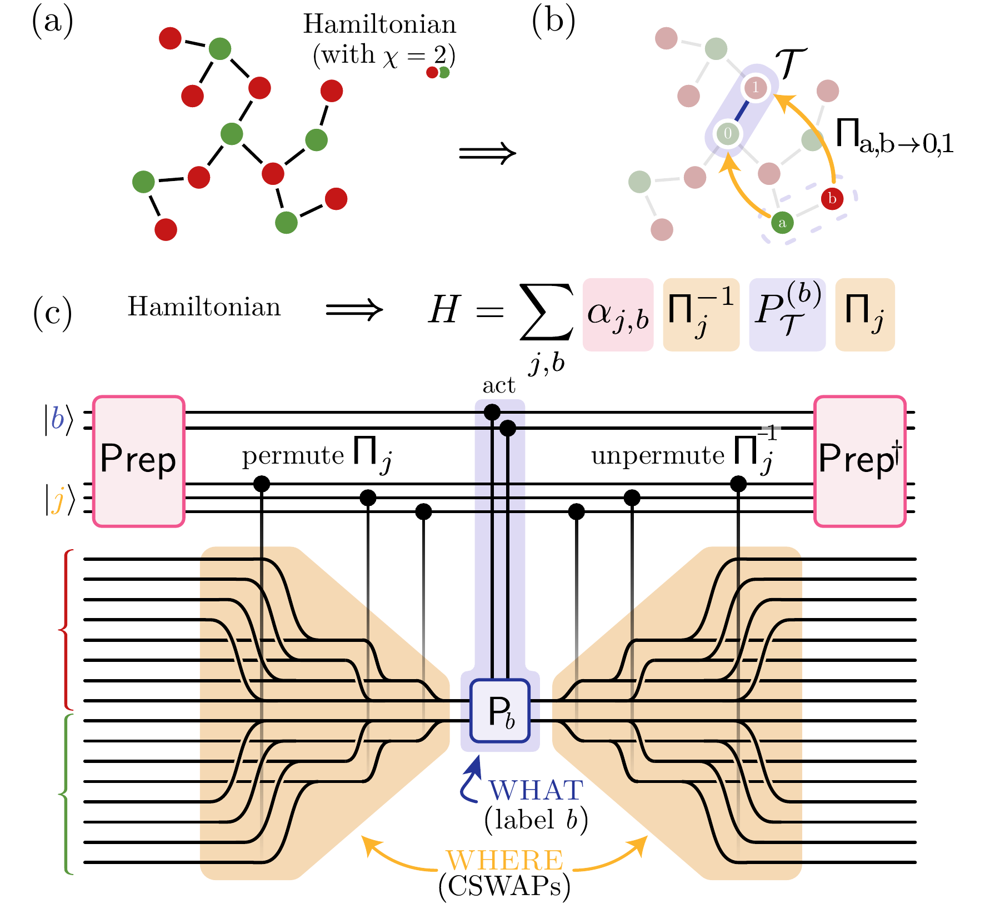

# Permute–act–unpermute

From
**[Efficient Block Encoding of Structured Hamiltonians by Separating Where and What](https://arxiv.org/abs/2610.03686)**
Alessandro Summer and François Jamet

PAU separates **where** a Hamiltonian term acts from **what** it applies.
A permutation network tailored to the support geometry—such as nearest-neighbour
bonds or all-to-all pairs—routes the selected sites to a fixed target register.
For Pauli Hamiltonians, a compact **X/Z mask** specifies which X and Z operations
to apply on each target qubit, with the required phase tracked separately.
The inverse permutation then restores the sites.

The support geometry determines the routing network; the operator label
determines the local mask. Many Pauli terms can therefore share the same
routing machinery, and families with different geometries can be combined
in one query.

[](https://arxiv.org/abs/2610.03686)

*Figure 1. Permute–act–unpermute block encoding. The support address controls
the permutation; the operator label controls the local action. Preparation
supplies their joint amplitudes.*

## Benchmarks

The [Fe₂S₂ benchmark](fe2s2/) applies PAU to a molecular Hamiltonian and
explores Toffoli–qubit tradeoffs with single- and multiple-family constructions.

- [Fe₂S₂ circuits and resource checks](fe2s2/circuits/)
- [Run the Fe₂S₂ reproduction](fe2s2/)

Each benchmark documents its problem instance, comparison methods, resource
conventions and verification scope. References and code/data credits accompany
the corresponding implementation.

## Citation

```bibtex
@misc{summer2026pau,
  title         = {Efficient Block Encoding of Structured Hamiltonians by Separating Where and What},
  author        = {Summer, Alessandro and Jamet, Fran{\c{c}}ois},
  year          = {2026},
  eprint        = {2610.03686},
  archivePrefix = {arXiv},
  primaryClass  = {quant-ph},
  url           = {https://arxiv.org/abs/2610.03686}
}
```
