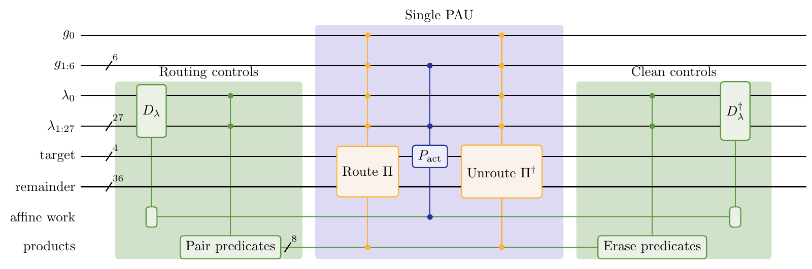
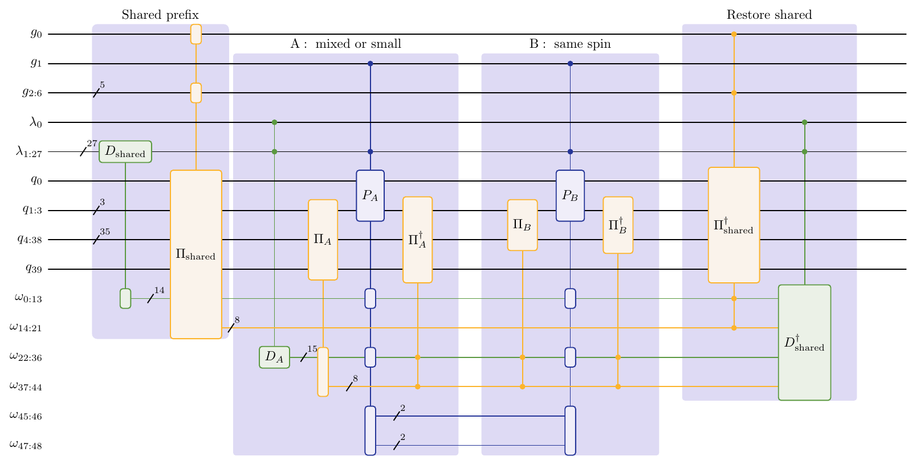

# Fe₂S₂ benchmark

This benchmark applies [permute–act–unpermute (PAU)](https://arxiv.org/abs/2610.03686)
to the [Li–Chan Fe₂S₂ Hamiltonian](https://github.com/zhendongli2008/Active-space-model-for-Iron-Sulfur-Clusters)
on 40 system qubits. PAU routes a selected
term's active modes to a four-mode target, applies its local Pauli action,
and reverses the routing. Single- and two-family implementations explore
the tradeoff between Toffoli count and peak logical qubits.

The [circuits](circuits/) folder contains 31 decomposed gate programs,
pinned reference data, modular Python generators, a resource counter and a
sampled simulator. Each published point has an explicit configuration. The
collection covers the PAU constructions and comparison circuits on the same
instance. Fe₂S₂ extends the case studies of the PAU paper.

## Forty modes: one- and two-family PAU cores

Both cores act on the same 40-mode system and collect active modes into four
target slots. Read left to right; a slash and number denote a wire bundle.
The inputs are already loaded labels and generator flags: alias sampling,
table lookup and label cleanup are outside these drawings. Yellow marks
routing, blue marks the local action, and green marks control preparation
and erasure.

### One family: a common routed-action core

[](assets/pau_single_core.png)

- **Routing controls:** decode the compact label with `Dλ` and compute the
  pair-selection predicates.
- **Single PAU:** `Π` routes the selected modes to the four targets;
  `P_act` applies the signed local Pauli mask; `Π†` restores the mode ordering.
  Different term types share this core, with identity action on padding modes.
- **Clean controls:** erase the pair predicates and reverse the label decoding.

### Two families: specialized actions with shared routing

[](assets/pau_two_family_core.png)

- **Shared prefix:** `D_shared` prepares reusable controls and `Π_shared`
  performs the common part of the routing once.
- **Family A and family B:** A handles mixed-spin or small-support terms;
  B handles three- and four-mode same-spin terms. Each has its own
  route → act → unroute sequence. Family controls enable the appropriate
  action on the same system and target slots.
- **Restore shared:** undo the common routing and erase the cached controls.
  The two families reuse workspace and do not require separate preparations.

## Run the checks

With Python 3.10+ and no third-party dependencies, from this directory:

```sh
python verify.py
```

This verifies the packaged checksums, recounts every circuit, reconciles its
phase ledger, checks the point data and report hashes, and tests 256 sampled
input/measurement trajectories per circuit. Expect a few minutes of runtime.
Use `--shots` and `--seed` to change sampling; `--report /path/report.json`
saves a new report. See [circuit verification](circuits/README.md#verification)
for the recorded full-suite results and the limits of these checks.

## Rebuild and inspect the circuits

The [circuit guide](circuits/README.md#rebuild-a-circuit) covers generation, native
upstream evaluation and OpenQASM 3 export. The [interfaces](circuits/interfaces/)
also provide decomposable Qualtran SELECT cores and full dynamic Cirq streams.
The [verification guide](circuits/verification/) separates fresh checks from
historical full-suite runs and states the coverage of each test.

## Resource boundary

Each program implements one pinned 41,052-term **alias–SELECT–unlookup** query:
16 address bits, 16 coin bits and 40 system qubits, plus live workspace.
Resources are **CCX + CCZ Toffoli equivalents** and peak total logical qubits.
Their product is a resource metric, not depth or physical runtime.
Uniform preparation, reflection, QPE and an additional external control are
excluded.

The best-product single-family PAU in this snapshot uses **5,650 Toffolis ×
210 qubits = 1,186,500**. These are tested implementations, not a proof of
global optimality. The release contains frozen gate programs and generators
that reproduce them exactly; it does not rerun the optimization search or
derive the molecular integrals.

## Comparison

Frame SELECT, used for this same Fe₂S₂ instance in the recent work of
[Gu et al.](https://arxiv.org/abs/2610.22367), is included as a comparison.
The release contains its published implementation, tuning within the paper's
methods, and an optimized variant.

Both optimized architectures receive applicable alias, decoder and cleanup
optimizations, retuned for their interfaces and space budgets. Comparisons
include data loading and cleanup as well as the SELECT core.

See [references and credits](circuits/README.md#references-and-credits)
and [BibTeX citations](references.bib).
Code is covered by the repository's Apache-2.0 license.
